# Extensible Dimension Database

**Model your business in the app, not in code, and make every fact in it governed, auditable, and ready for AI.**

Extensible Dimension Database is a metadata-driven data platform for the records that run your operation: locations, products, vendors, assets, or anything else you need to track. Administrators shape the data model right in the browser. They add record types, dimensions, and attributes, set validation, build cascading choice lists, link records to each other, and decide who can see or edit each field. There are no migrations, no deploys, and no developer in the loop. Everyone else gets a clean, searchable grid and record forms that change as the model changes.

The structure is only the start. Built-in workflows turn data changes into work: a new record or a changed field can notify the right people, or start an action sequence with assignees, deadlines, required fields, and overdue alerts. Every edit is recorded with the before value, the after value, who made it, and when, and every administrative change lands in an audit log. Access is granted to groups down to the single attribute, with per-person exceptions, and people can sign in with your identity provider.

The data is also built to be used outside the app:

- **AI-ready by design.** Each person can connect Claude, Cursor, or any MCP-capable assistant with their own token, and the assistant sees only what that person is allowed to see. Attribute names and descriptions explain what each fact means, so the model gets context and not just raw values. Assistants can also propose changes, but nothing is saved until a person approves it, and approved changes land in the changelog like any other edit.
- **Partner-ready integration.** Publish any slice of your data as a JSON or XML endpoint, push signed webhooks to other systems when records change, and bring data in with a CSV import that checks every row before anything is saved.
- **Domain-agnostic.** The same engine handles a location portfolio (the included sample data), a product catalog, or a vendor registry. Adding a new kind of record is a configuration change, not a code change.

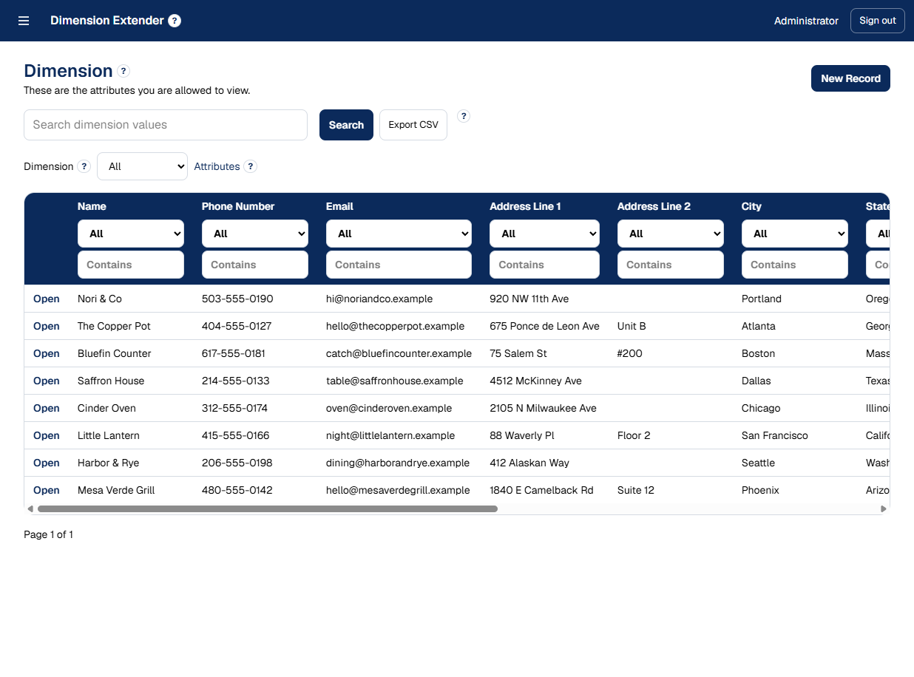

The name in the header, on the sign-in page, and in the browser title is a site setting. The screenshots in this README come from a local site named **Dimension Extender**, with the sample locations and a Vendor record type added.

## Contents

- [Getting started](#getting-started)
- [What you can define](#what-you-can-define)
- [Working with records](#working-with-records)
- [Workflows and the dashboard](#workflows-and-the-dashboard)
- [History: changelog and audit log](#history-changelog-and-audit-log)
- [AI access](#ai-access)
- [Sharing and integration](#sharing-and-integration)
- [Administration](#administration)
- [Security](#security)
- [Configuration](#configuration)
- [Operations](#operations)
- [Stack](#stack)

## Getting started

### With Docker

```bash
cp .env.example .env      # set AUTH_SECRET, and ADMIN_PASSWORD for the first start
docker compose up -d
```

This starts PostgreSQL and the app on [http://localhost:3000](http://localhost:3000). On every start the app applies migrations. On the first start against an empty database it also loads the sample data.

### On your machine

1. Install Node.js and PostgreSQL.
2. Create the database and role named in `.env.example`, and allow that role to use the `public` schema (`prisma/grant.sql` has the statements).
3. Copy the example environment file and set a long random `AUTH_SECRET` of at least 32 characters:

   ```bash
   cp .env.example .env
   ```

   On Windows PowerShell: `Copy-Item .env.example .env`

4. Install dependencies, apply the migrations, load the sample data, and start the app:

   ```bash
   npm install
   npx prisma migrate deploy
   npm run db:seed
   npm run dev
   ```

5. Open [http://localhost:3000](http://localhost:3000) and sign in as `admin@local`.

The seed creates the administrator, the Location record type with its starting dimension, the US state and city lists, and sample restaurant records. Set `ADMIN_PASSWORD` in `.env` before the first seed to choose the administrator's password. If you leave it unset, the seed prints a one-time password and does not print it again on later runs. Running the seed again is safe.

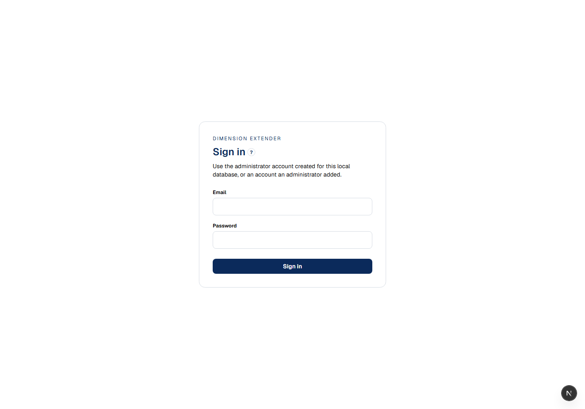

### Finding your way around

The menu groups the screens into the main work area, Dimension Config, People Config, and Settings. Each person sees only the screens they have been granted.

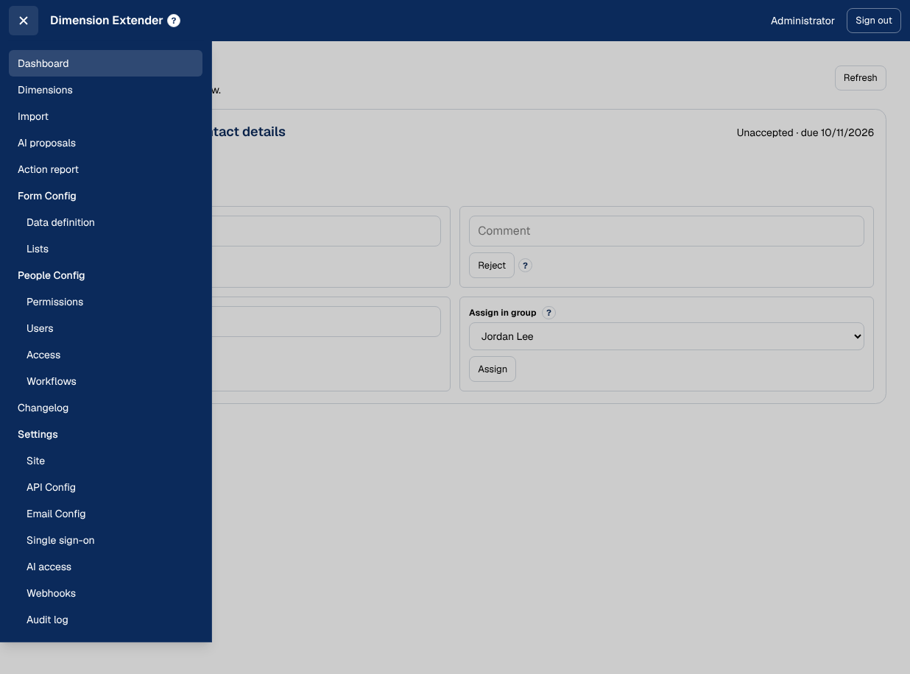

## What you can define

- **Record types** are the kinds of records you keep: locations, vendors, products, or anything else. Each type has its own dimensions, attributes, unique identifier, and records, and its own tab on the Dimension page. A database starts with one type, Location.
- **Dimensions** group the attributes of a record type, such as General or Vendor profile. Dimension names are unique across types.
- **Attributes** are the fields on a record. Each has a key, a display name, a description, a type, and optional rules: required, maximum length, a regular expression, a default, a unique identifier, an active-filter checkbox, or an automatic created date. Types are text, big text, numeric, date, time, date and time, checkbox, radio, list, zip code, address, email, phone, coordinate, and **link to record**.
- **Links** connect records across types. A link attribute points to one or several records of a chosen type, such as a location's vendors. People pick linked records by their unique identifier, and every linked record lists what points to it under **Linked from**.
- **Lists** supply choices. A list can follow another list, so cities follow states, and new parent-child catalogs can be added the same way.
- **People** are users and groups. Screens and record access are granted to a user or a group. A person's own grant overrides their groups, and a person in several groups gets the combined access.
- **Workflows** are a notification or an action sequence. They start when a record is created, when an attribute changes, or by hand.

## Working with records

### The grid

The Dimension page is the working grid, with a tab for each record type. Search, filter each attribute, choose which attributes are visible, and open a record. **New Record** starts a blank record of the type you are viewing. **Export CSV** downloads the rows that match the current search and filters. **Export MD** downloads every record you can view as Markdown knowledge cards, for use with an AI model.

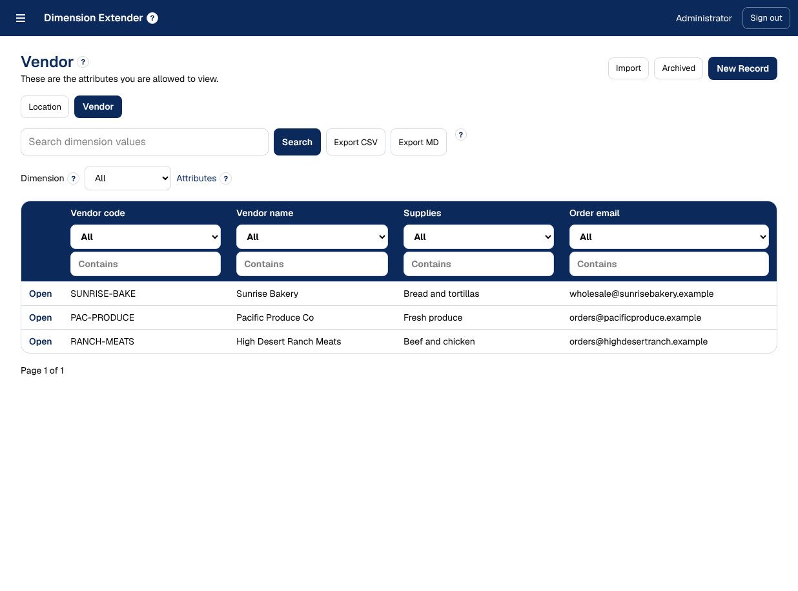

### A record

A record is edited by dimension, and shows only the attributes you may view; the ones you cannot update are read only. List attributes that follow another list, such as city after state, reload when the parent changes. A link attribute, here **Vendors**, lets you pick records of another type. The page also shows the latest edits and can start any workflow that allows a manual start for that type.

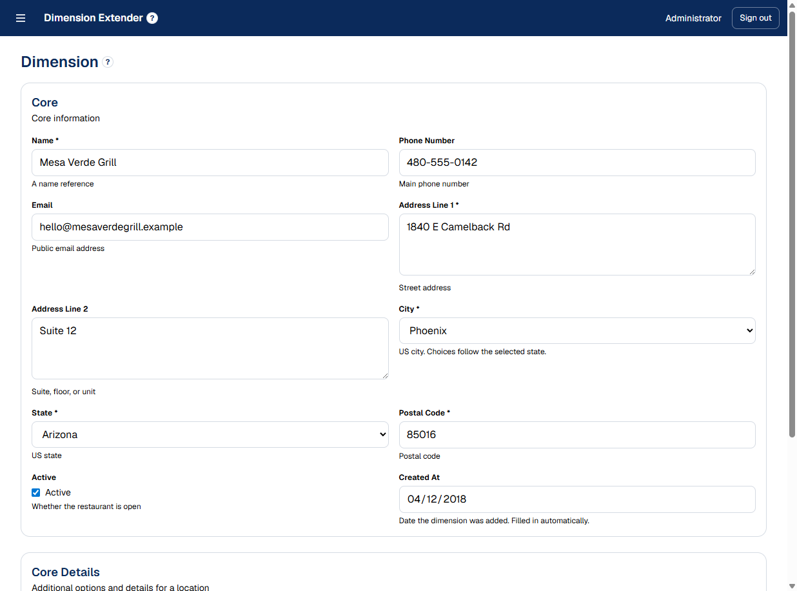

The linked record lists everything that points to it:

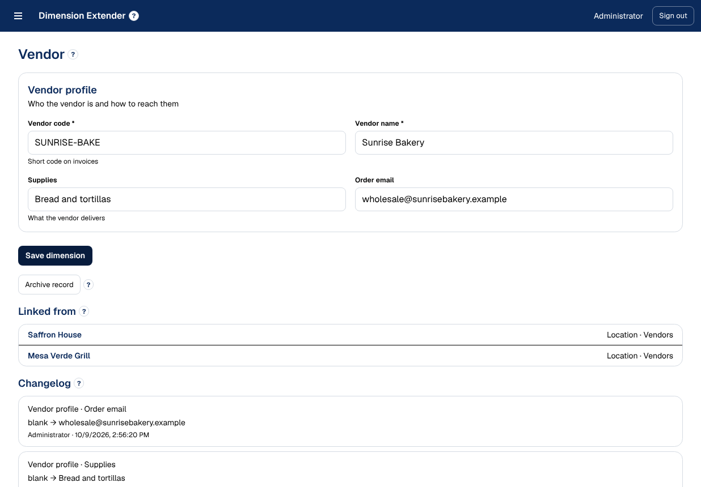

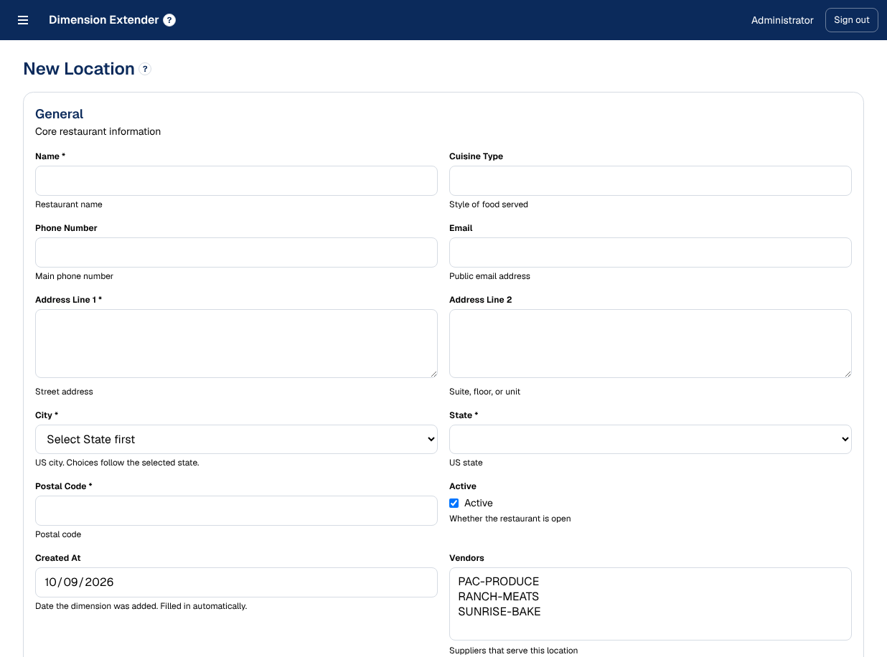

### Archiving

**Archive record** hides a record from the grid, exports, the share API, and AI knowledge, blocks edits, and pauses its open workflows. Its values and changelog are kept. **Archived** on the Dimension page lists archived records, and **Restore** brings one back and resumes the workflows that archiving paused. A link to a record that was archived later is kept and marked as archived, so saving the linking record does not drop it.

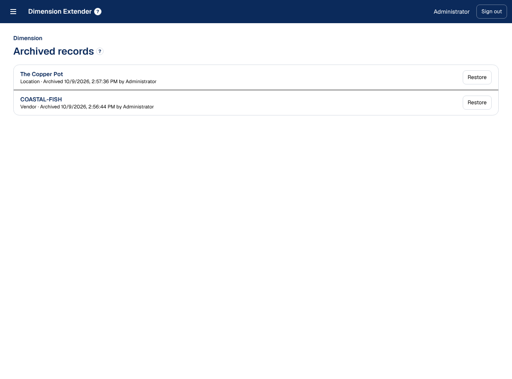

### Import

**Import** creates and updates records from a CSV file. Choose the record type, then upload. Headers are attribute keys or display names, so a file from Export CSV can be edited and imported back, including choice labels, Yes and No, dates as MM/DD/YYYY, and linked records by their identifier. When the file has the unique identifier column, matching rows update existing records and the rest create new ones.

Nothing is saved when you upload. Every row is first checked with the same rules as the record form, and the preview shows how many rows will be created, updated, or skipped, the reason for each error, and how each column was matched. Rows with errors are skipped when you confirm. Imported changes are written to the changelog and sent to webhooks; running workflows for them is optional, so a large import does not send a notification for every row.

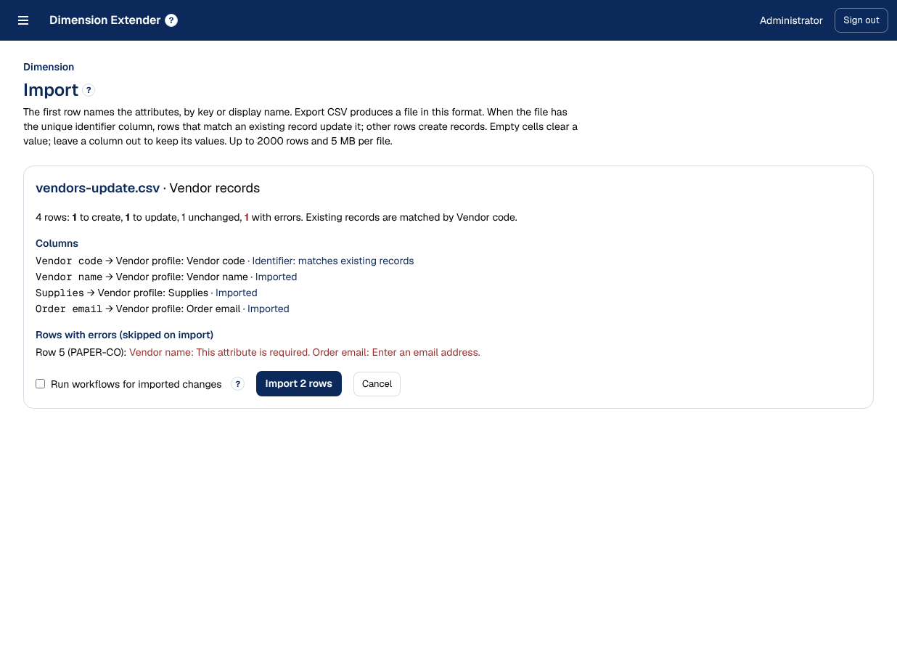

## Workflows and the dashboard

A workflow is a notification or an action sequence:

- **Notify** sends the previous value, the new value, who saved it, and when. Recipients are groups and specific users. A recipient who is not allowed to view the changed attribute is told that a record changed, without the attribute or its values.
- **Action sequence** runs its steps in order. An **action** step assigns work to a group, with an optional person and a deadline, and can require an attribute to have a value or to have been changed after the action opened. A **notify** step sends a notice to a group, a person, or both, with a link to the record, and the sequence moves straight on to the next step.

Workflows and steps can be deleted. A step is refused while a record is waiting on it; deleting a workflow removes its run history, so clear **Active** instead to keep it.

Triggers are record created, attribute change, and manual start. Each trigger attribute has a condition: any change, becomes, changes from, new value contains, becomes empty, or gets a value; text comparisons ignore upper and lower case. A workflow limited to dimensions, or triggered by attributes, applies only to records of those types; leave both empty to apply it to every record. Dimensions and attributes are listed by record type.

A workflow that cannot run as set up, such as one with Attribute change on but no attributes chosen, or a Notify workflow with no one to notify, is marked **Needs attention** with the reason. Changing a workflow between Notify and Action sequence asks first, and keeps the hidden steps or notify list in case it is changed back. A workflow that records are part-way through says so, and explains how step changes reach them.

Overdue actions are found every 15 minutes. An action assigned to a person alerts that person; an unassigned one alerts its group. Whoever started the workflow and anyone watching the action are alerted too.

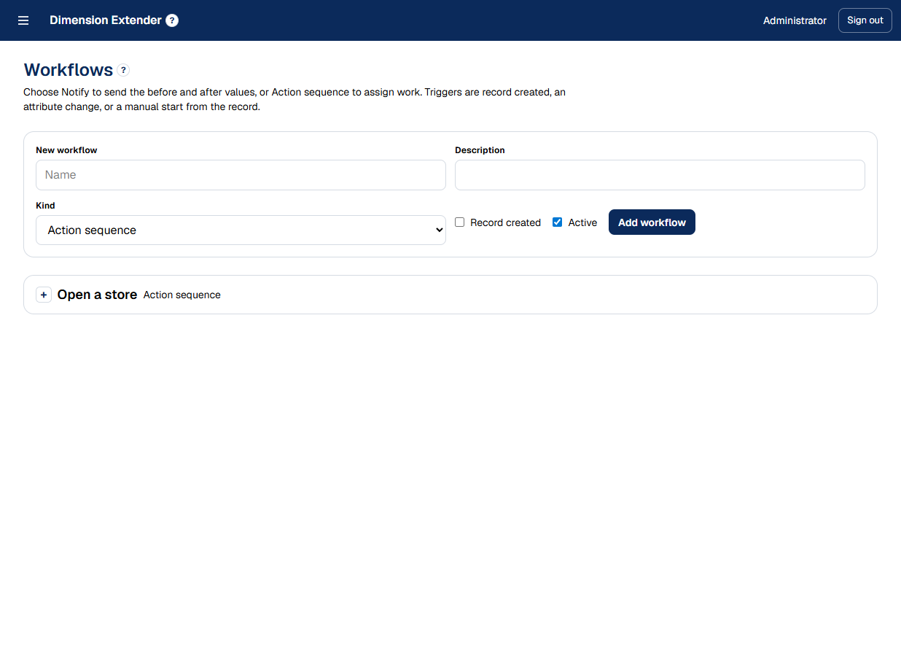

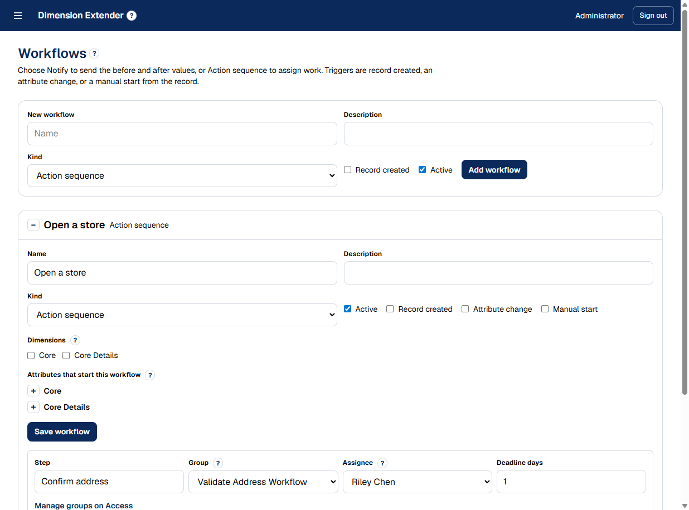

The dashboard is each person's own view of what is happening:

- **Your last 7 days**: edits, records touched, actions completed, overdue actions, and a 30-day sparkline of your edits.
- **Needs your attention**: overdue actions and actions due in the next two days, AI proposals waiting for your review, your own proposals that were just approved or rejected, and watched records that changed since your last visit.
- **Open actions** assigned to you or to a group you belong to. Accept, complete, reject, comment, and reassign an action from its card. Opening an action goes to the record and highlights the attributes that step requires.
- **Changes to records you watch**: other people's edits in the last 14 days, grouped by record, with **New** on anything since your last visit. Watching is always your own choice: click the eye at the top of a record to watch it, and click it again to stop. The eye is filled while you watch and shows how many people are watching.
- **Your recent edits**: the records you edited in the last 14 days, with the attributes you changed, as a quick way back to your work.
- **Notices** from notify steps and change notifications.

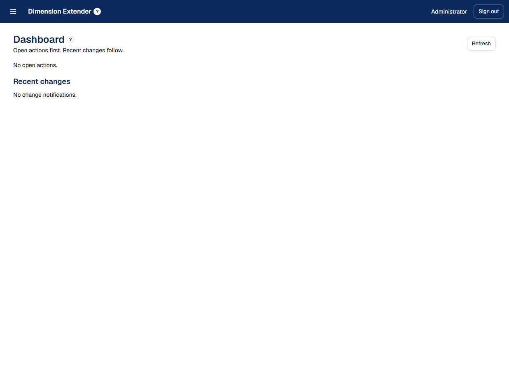

The action report reviews actions and their history. Filter by group, user, dates, and record. Open actions can be postponed or suspended from here.

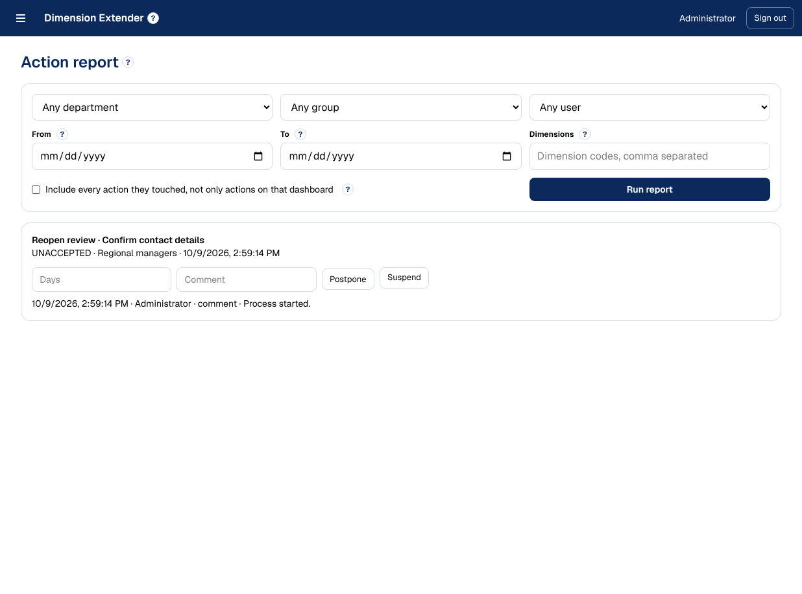

## History: changelog and audit log

**Changelog** records every saved attribute change with the old value, the new value, the person, and the time. Filter by text, record, dimension, attribute, person, and date. Changes that came from an approved AI proposal are marked.

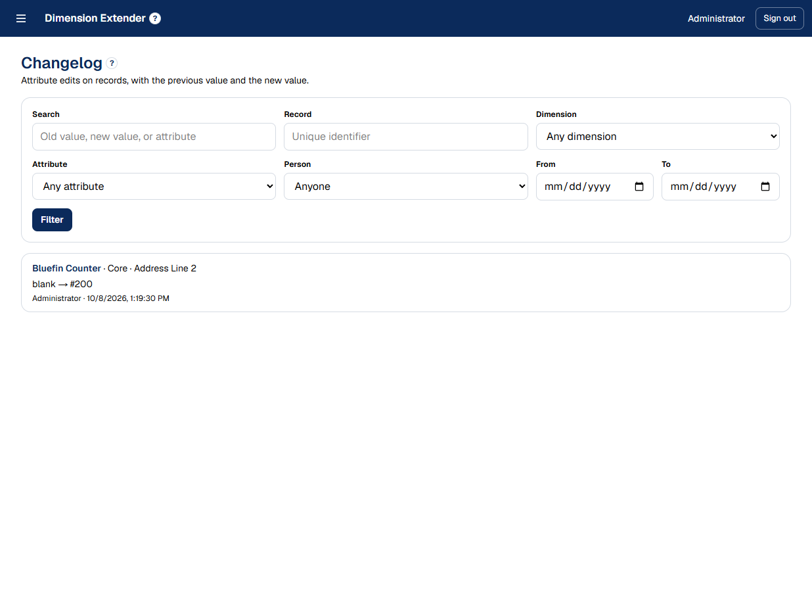

**Audit log** records every successful administrative change: record types and data definitions, lists, users, groups, permissions, workflows, API endpoints, webhooks, AI tokens and proposal reviews, single sign-on, email and site settings, sign-ins, and archiving. Each entry shows who made it, when, and the submitted values. Passwords and secrets are never recorded.

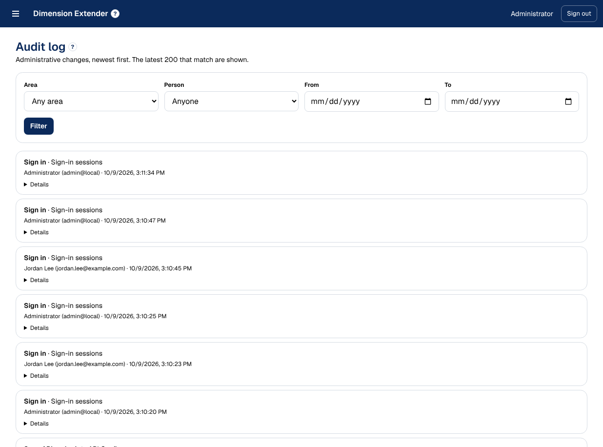

## AI access

The database works as a knowledge source for AI assistants. The schema (record types, dimensions, attribute names, descriptions, and lists) tells a model what each fact means, and records are retrieved as short knowledge cards when a question needs them. The contract is an MCP server with a `schema` resource and `search_records`, `get_record`, `read_file`, and `recent_changes` tools. Assistants can read and search the text of documents on File attributes (PDF, Word, Excel, PowerPoint, text, CSV), so a question about a policy is answered from the handbook itself, described in [docs/ai-knowledge.md](docs/ai-knowledge.md).

**Per person.** The app serves MCP at `/api/mcp`, and an assistant answers only from what its person can view. **AI access** offers two ways to connect:

- **Chat assistants.** ChatGPT, Claude, and Grok on the web sign in with OAuth: the person adds the connection URL as a custom connector, signs in, and chooses **View only** or **View and propose**. There is no key to copy. An administrator turns each assistant on, and connecting the same assistant again replaces the earlier connection.
- **Developer tools.** Claude Code, Cursor, the Grok CLI, and API calls use a personal token, with setup for each one on the page. Only a hash of each token is stored. Tokens can expire, and their owner can revoke them.

Each person can change an assistant's access or disconnect it at any time, and administrators see every connection and token in one table and can end any of them.

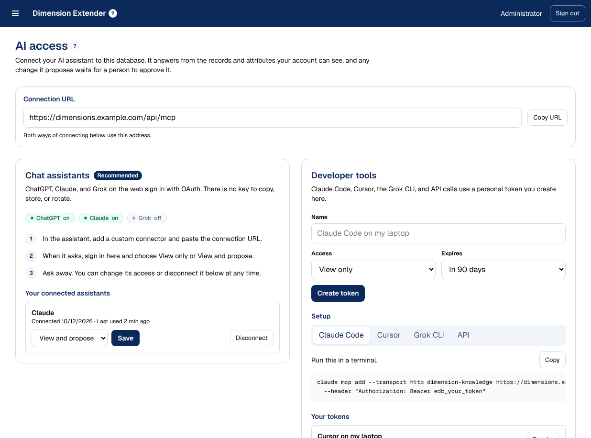

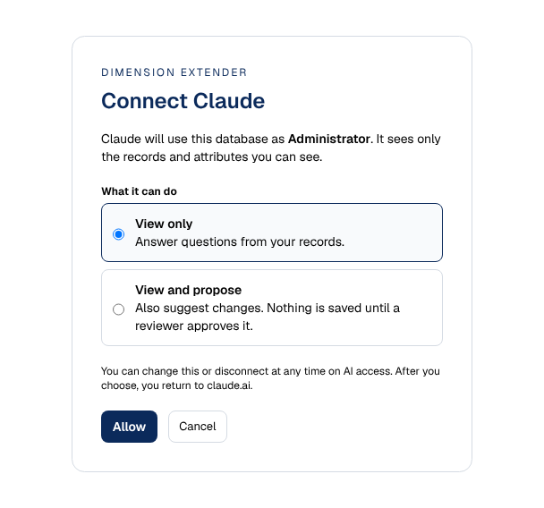

**Governed write-back.** A connection or token with **View and propose** adds a `propose_change` tool. The assistant's change is checked with the record form's rules, and errors go straight back to the model. A valid proposal waits on **AI proposals** with the assistant's reason, the current value, and the proposed value. Nothing is saved until someone approves it. Reviewers can only approve attributes they may update, and someone other than the assistant's owner must review a proposal unless the reviewer is an administrator. An approved change is validated again and saved like a form edit, with the changelog, workflows, and webhooks.

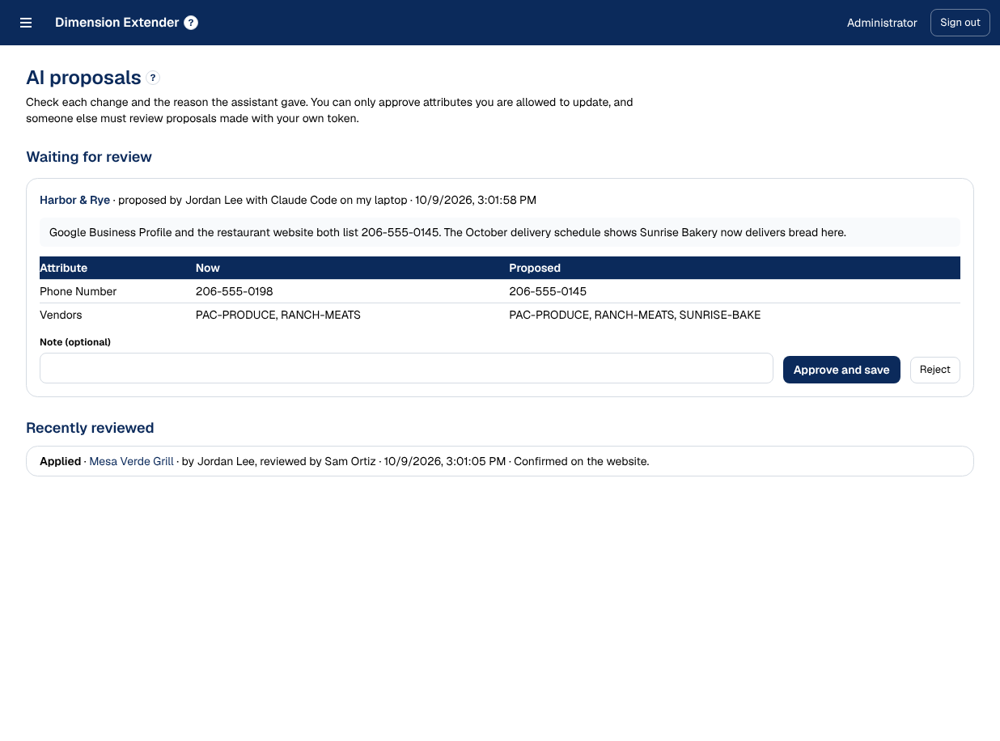

**Local and read-only.** `npm run mcp` runs the same read tools over stdio as the user named in `MCP_USER_EMAIL`, for a model on the same machine.

For a one-off handoff without MCP, use **Export MD** on the grid.

## Sharing and integration

**API Config** publishes a share endpoint: choose JSON or XML, an optional date window, and the dimensions or attributes to include. Callers send the secret as `Authorization: Bearer`. Only a hash of the secret is stored, so it is shown once, when the endpoint is created or the secret is regenerated. A caller that sends the wrong secret more than 5 times is blocked from that endpoint for an hour.

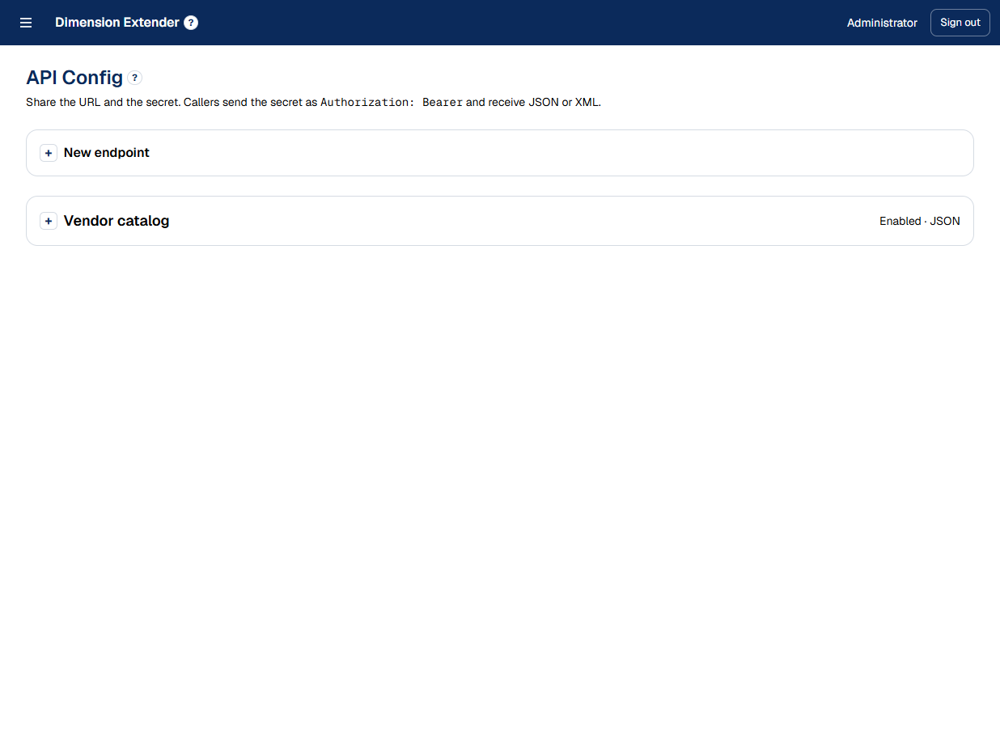

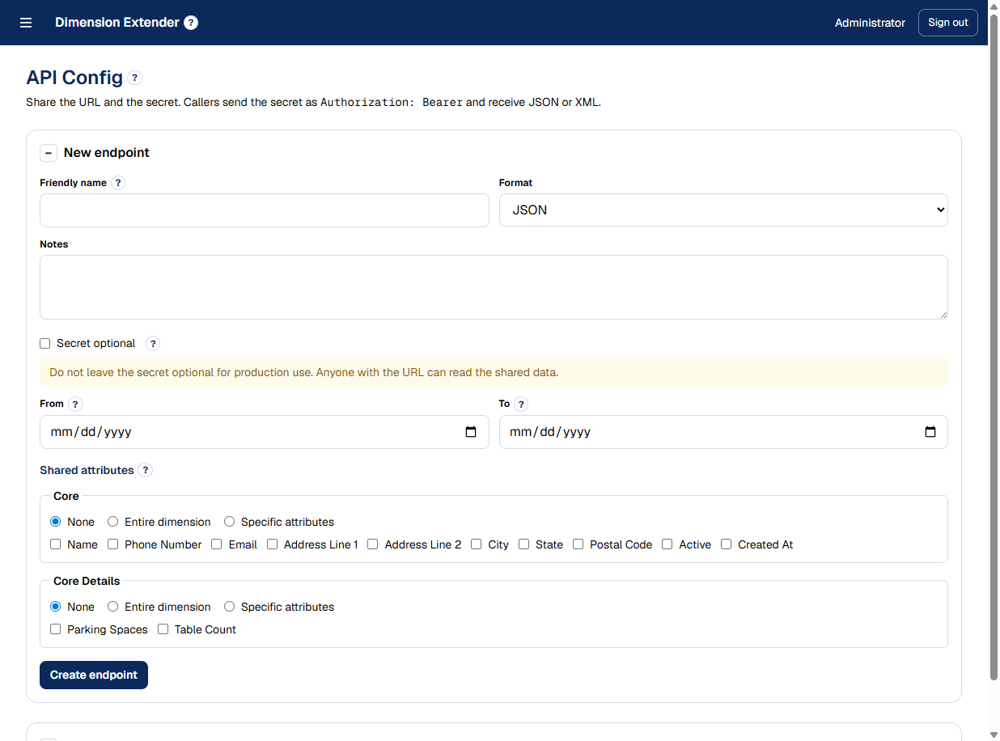

**Webhooks** send a signed JSON message to another system when records are created, updated, archived, or restored, optionally limited to certain dimensions. Each request carries an `X-Dimension-Signature` header, `t=<unix time>,v1=<HMAC-SHA256 of "t.body">`, so the receiver can verify it. Failed deliveries are retried for about a day, and each webhook shows its recent deliveries with a manual retry and a **Send test** button. Webhooks only reach public `https://` addresses unless `WEBHOOK_ALLOW_PRIVATE=true`.

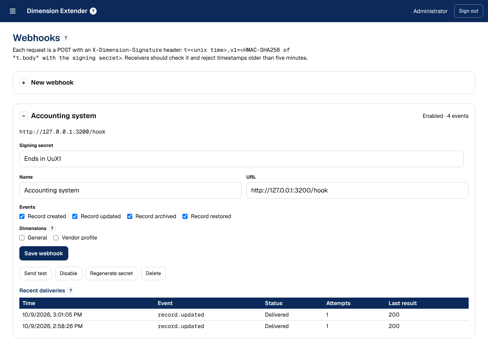

## Administration

### Data definition

Record types are managed at the top of the page: add a type, rename it, or hide it. Dimensions are grouped by type, and a new dimension is added to the type you choose. Each dimension starts collapsed. Open it to rename it, reorder attributes, hide or delete them, and add an attribute. Deleting an attribute that already has values asks for confirmation, then removes those values so nothing is left dangling.

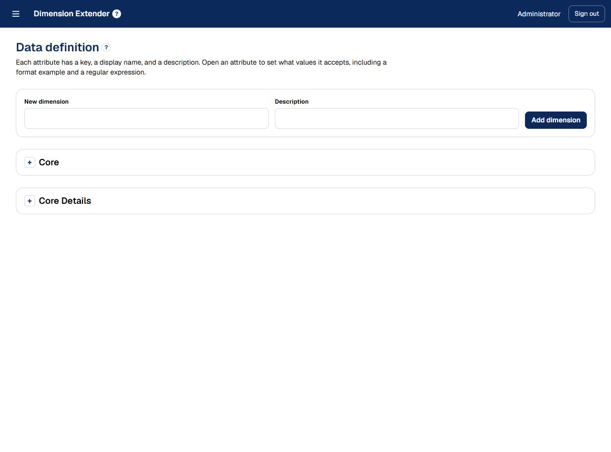

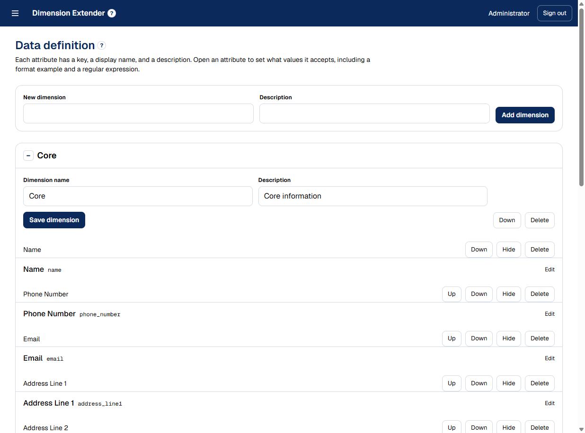

A **File** attribute holds uploaded documents, such as a supplier agreement or a food safety certificate, stored in PostgreSQL with the record:

- Choose the accepted types (PDF, Word, Excel, PowerPoint, text, CSV, PNG, JPEG; all of them when left blank) and whether it holds one file or several.
- On a record, people with update rights add files with the picker and remove them with **Remove**. Files are saved, or discarded, together with the rest of the record. With a single-file attribute, a new upload replaces the old file.
- Up to 10 MB per file and 25 MB per save. Each file's first bytes must match its extension, so a renamed executable or web page is refused.
- PDFs and images open in the browser; other files download. A file is only served to someone who may view that attribute on that record, and removed files are deleted.
- The grid, exports, changelog, notices, and AI tools show the file names, and AI assistants can read and search the files' text with `read_file`. CSV import skips file columns, and AI proposals cannot add files.

A link attribute names the record type it points to and whether it holds several records:

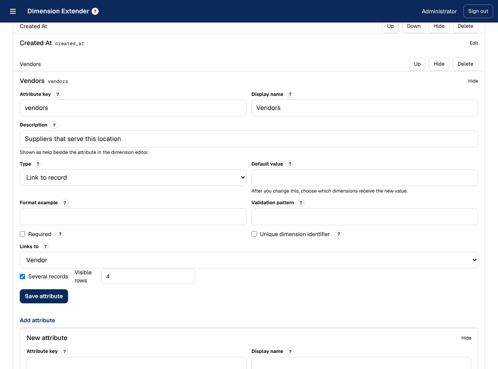

### Lists

Create a list, optionally set which list it follows, and manage its items. Child items can be limited to values from the parent list. US States and US Cities use this same mechanism and can be edited here.

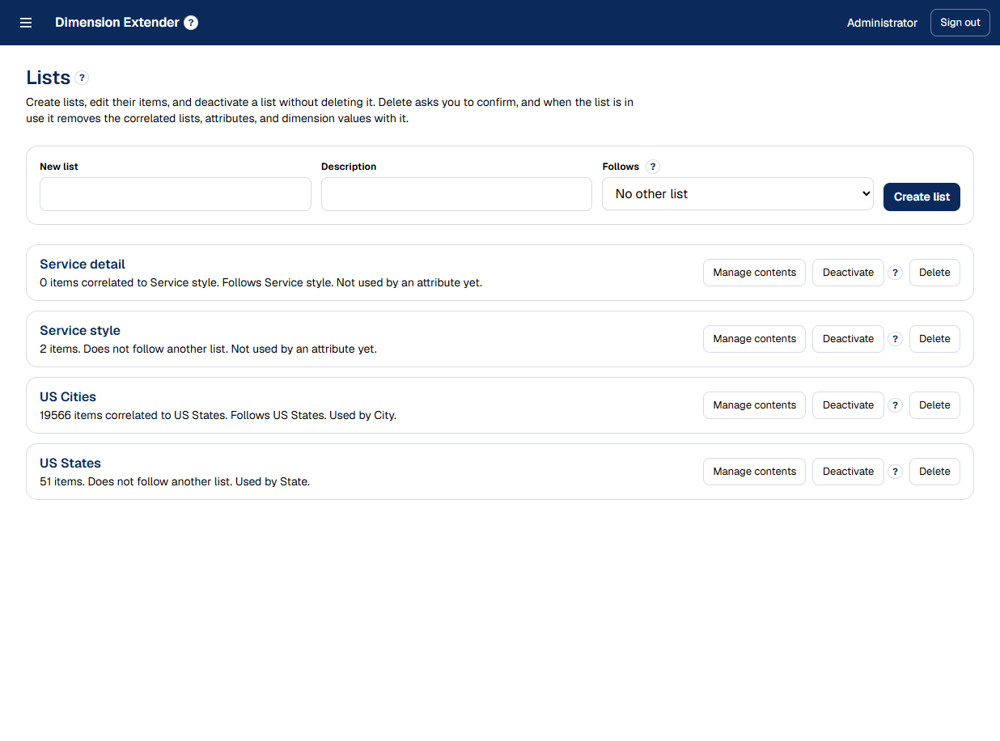

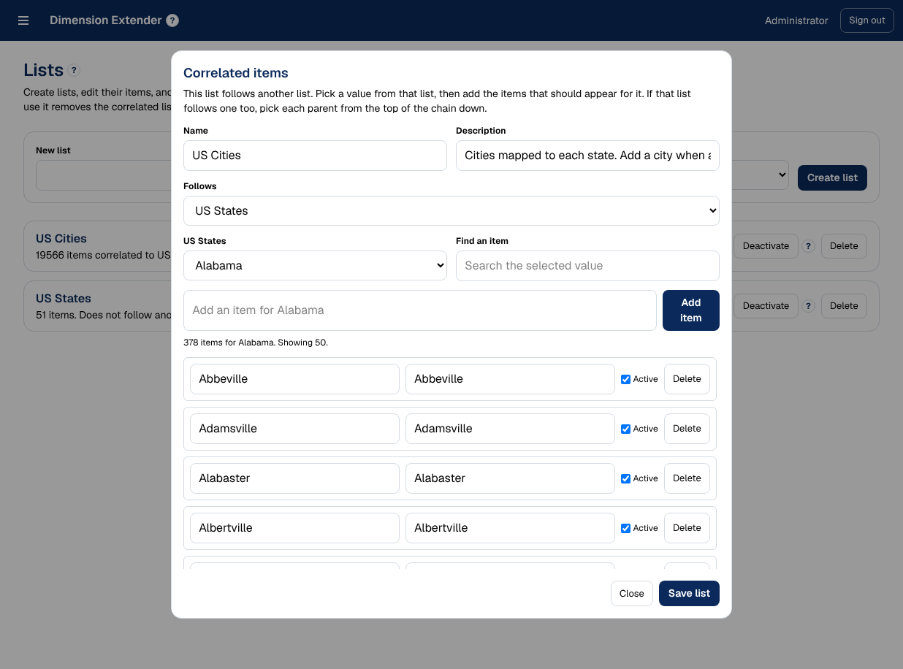

### People and permissions

Permissions are assigned to **groups**. A person gets the combined permissions of every group they belong to, and their own page can make an exception for a single item.

**Groups** creates groups and holds everything they grant. Open a group to see its members and set:

- **Screens**: None, View, or Edit for each screen.
- **Dimensions**: data access for the entire dimension (None, View, or Edit, which also covers attributes added later) or for specific attributes, plus the admin rights to add, hide, or edit attributes, edit the dimension, and assign its permissions.

A person in several groups gets the higher level and every right any of their groups gives. Someone who is not an administrator can change a dimension's permissions only if they have **Assign permissions** on it.

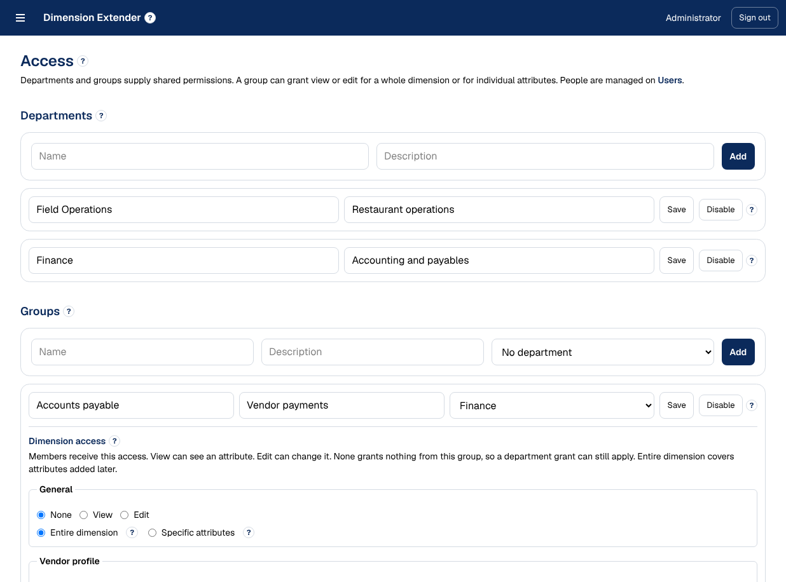

**Passwords.** Anyone who signs in with a password can change it from the menu under their name at the top right (**Change password**). It asks for the current password, signs out their other browsers, and is rate-limited like sign-in. When single sign-on applies to someone (they have signed in through the provider, or password sign-in is limited to administrators and they are not one), the option is hidden and the provider manages their credentials.

A password an administrator sets for someone who is not an administrator, whether on a new account or as a reset, is temporary: that person must choose their own the next time they sign in before they can do anything else. On upgrade, existing non-administrator accounts that have never signed in are treated the same way.

**Users** creates accounts, marks administrators, and adds people to groups. A user's page changes their password, assigns workflow steps, lists the browsers they are signed in on with **Sign out everywhere**, and has **Own settings**: every screen, dimension, admin right, and attribute starts at **From groups**, which shows what their groups give now. Choosing None, View, Edit, Yes, or No makes an exception that overrides their groups for that one item, so you can also take a single attribute away from one person. Changing Own settings needs Edit on Groups.

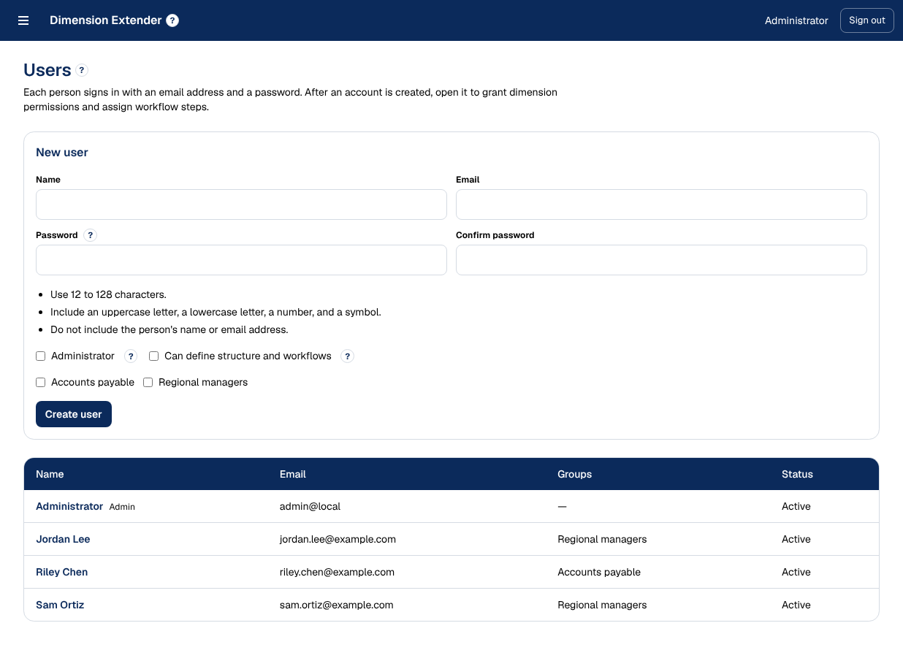

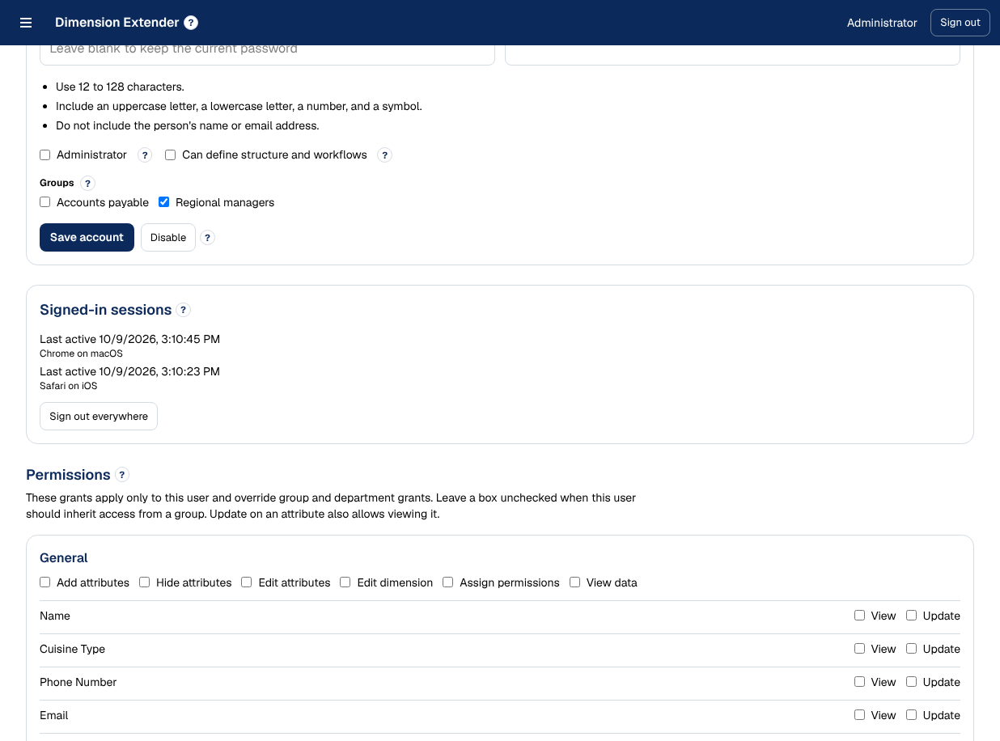

**Upgrading from a version with a Permissions page.** Groups' permissions and everyone's effective access stay the same. A person's old grants become exceptions only where they actually differ from their groups; everything else now follows their groups. The Permissions screen is merged into Groups, so anyone who could open or change Permissions now has the same level on Groups.

**Upgrading from a version with departments.** Each department becomes a group with the same name, whose members are everyone in the groups that were linked to it, and its grants move across unchanged. Where one of a person's groups used to hold back something their department granted, that person now has the department's access. Run `docker compose exec app npm run report:department-merge` after upgrading to list exactly who gained what.

### Single sign-on

**Single sign-on** connects any OpenID Connect provider: Microsoft Entra ID, Google Workspace, Okta, Auth0, Keycloak, and others. Register the redirect URI the page shows with your provider, enter the issuer, client ID, and client secret, and a sign-in button appears on the sign-in page. People sign in to their existing account by verified email, and the provider's identity is linked on first use. Optionally, accounts are created on first sign-in for allowed email domains and added to a group, and password sign-in can be limited to administrators.

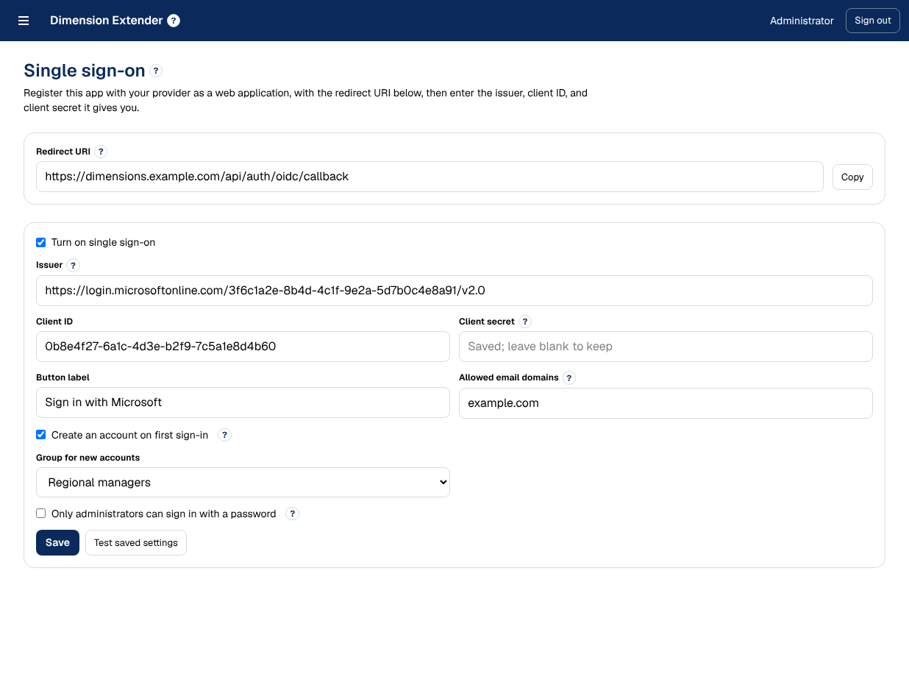

### Site and email

**Site** sets the name used in the header, on the sign-in page, in the browser title, and at the start of email subjects.

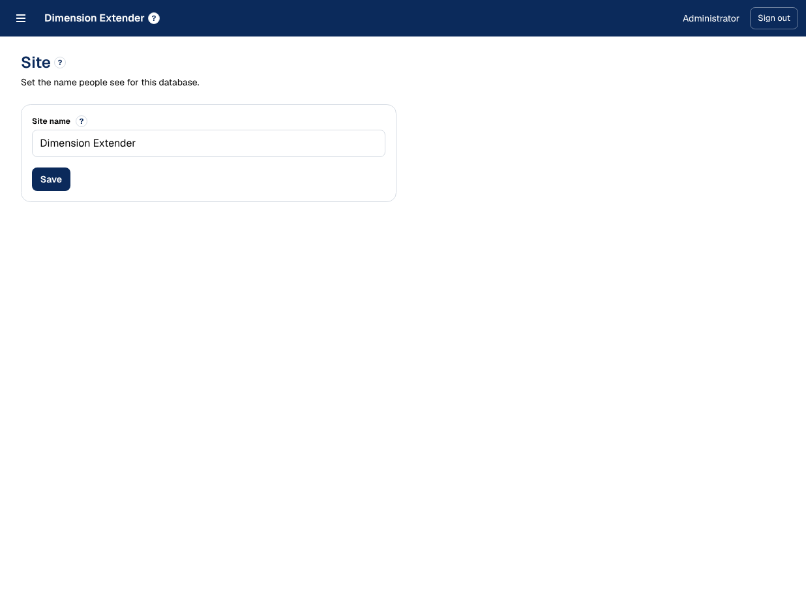

**Email Config** stores the SMTP server, port, security (none, STARTTLS, or TLS), username, and password. The password is encrypted and not shown again after it is saved. Messages are always stored in the app, including when email is off.

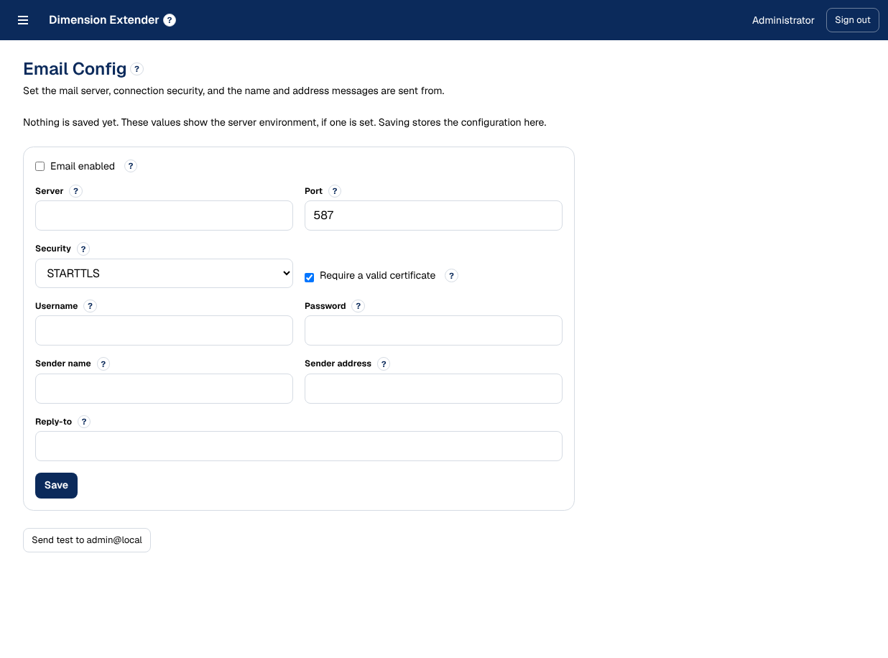

## Security

- **Sessions** are stored on the server. Signing out ends that browser's session. Changing a password or disabling an account signs the person out everywhere.
- **Sign-in throttling** slows guessing without locking anyone out: after 5 failures for an email, each attempt waits a little longer, up to 5 minutes. Repeated failures from one address are blocked per address.
- **Attribute permissions apply everywhere.** Notifications, emails, the dashboard, the changelog, exports, and AI tools only show values a person is allowed to view.
- **Secrets are stored hashed or encrypted.** Share secrets and AI tokens are hashed and shown once. Webhook signing secrets, the single sign-on client secret, and the SMTP password are encrypted with `AUTH_SECRET`.
- **Record saves are all-or-nothing**, and unique identifiers are checked under a database lock, so two people cannot save the same identifier at once.
- **AI changes need a person.** Assistants can only propose; a reviewer with rights to every attribute in the change approves it.
- **Single sign-on** uses the authorization code flow with PKCE, state, and nonce, and validates the ID token.
- **Behind a reverse proxy, set `TRUST_PROXY=true`** so the app sees each caller's real address. Without it, every remote caller shares one address, and per-address throttling is turned off rather than blocking everyone.

## Configuration

Settings are read from `.env`. Only `DATABASE_URL` and `AUTH_SECRET` are required.

| Variable | Purpose |
| --- | --- |
| `DATABASE_URL` | PostgreSQL connection string. |
| `AUTH_SECRET` | A unique random string of at least 32 characters. Signs sessions and encrypts stored secrets. |
| `ADMIN_PASSWORD` | Password for `admin@local`, used only when the seed creates that account. |
| `APP_URL` | Public address of the app, such as `https://dimensions.example.com`. Used for the single sign-on redirect URI. |
| `TRUST_PROXY` | `true` when a reverse proxy sets `X-Forwarded-For` to the real client address. |
| `SMTP_HOST`, `SMTP_PORT`, `SMTP_USER`, `SMTP_PASSWORD`, `SMTP_FROM` | Email delivery until Email Config is saved. |
| `SCHEDULER` | `off` to stop the built-in background jobs and use an outside scheduler. |
| `OVERDUE_CHECK_MINUTES` | Minutes between overdue checks. Default 15. |
| `ALERT_SECRET` | Secret for `POST /api/alerts/overdue`, for an outside scheduler. |
| `WEBHOOK_ALLOW_PRIVATE` | `true` to let webhooks reach `http://` and private network addresses, for testing. |
| `MCP_USER_EMAIL` | The user the local stdio MCP server (`npm run mcp`) answers as. |

## Operations

**Background jobs.** The app checks for overdue actions every 15 minutes, delivers queued webhooks every 20 seconds, and cleans up expired sessions, throttling counters, old deliveries, and unused import files every 6 hours. When several app servers share one database, a database lock makes sure only one runs each job. To use an outside scheduler for overdue alerts instead, set `SCHEDULER=off` and have it `POST /api/alerts/overdue` with the `x-alert-secret` header set to `ALERT_SECRET`.

**Upgrading.** Run `npx prisma migrate deploy` after pulling. Migrations keep existing data: share secrets are converted to hashes in place, and existing dimensions and records become the Location record type. After the upgrade that moves sessions to the server, everyone signs in once more.

**Checks.** Run `npm run typecheck`, `npm run lint`, and `npm test`. GitHub Actions runs them on every pull request, along with every migration and the seed against an empty PostgreSQL database, and a production build.

## Stack

- Next.js 16 (App Router) and React 19
- TypeScript and Tailwind CSS 4
- PostgreSQL with Prisma 6
- Server-side sessions behind a signed httpOnly cookie
- OpenID Connect single sign-on with openid-client
- Model Context Protocol server (stdio and Streamable HTTP)
- Nodemailer for optional SMTP delivery
- Vitest for tests
