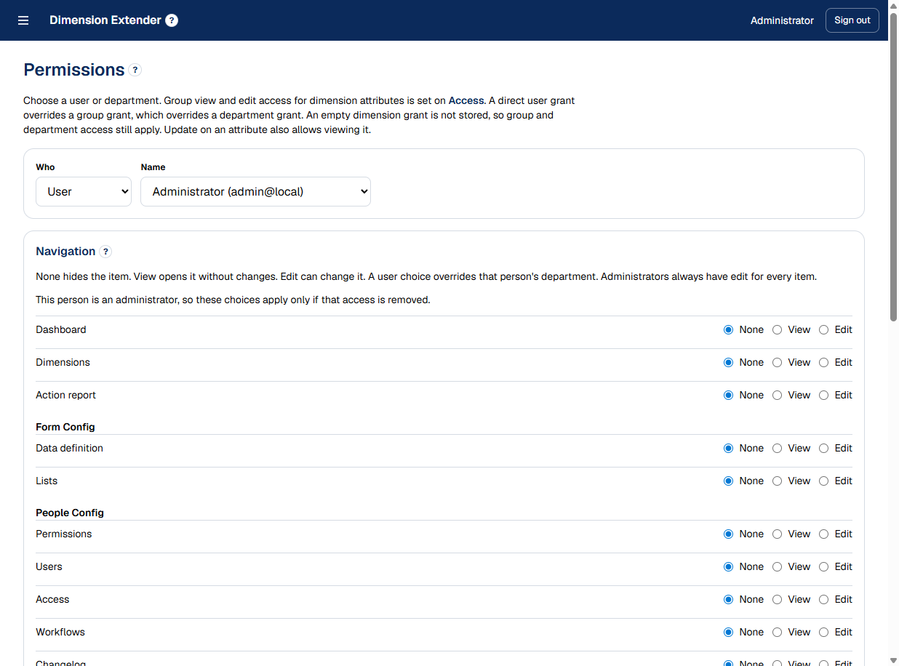

# Extensible Dimension Database

A metadata-driven extensible database and web application for records whose shape is defined in the product, not in code. Administrators create dimensions and attributes, choice lists, people, access rules, and workflows. Everyone else works with the records those definitions produce.

The name in the header, on the sign-in page, and in the browser title is a site setting. The screenshots below are from a local site named **Dimension Extender**.

## What you can define

- **Dimensions** group attributes. A record is one row that can hold values from every dimension the person is allowed to see.
- **Attributes** are the fields on a record. Each attribute has a key, a display name, a description, a type, and optional rules: required, maximum length, a regular expression, a default, a unique identifier, an active-filter checkbox, or an automatic created date.
- **Lists** supply choices. A list can follow another list, so cities can follow states, and new parent-child catalogs can be added the same way.
- **People** are users, departments, and groups. Navigation and record access are granted to a user, a group, or a department. A user grant overrides a group grant, which overrides a department grant.
- **Workflows** are either a notification or an action sequence. They can start when a record is created, when an attribute changes, or when someone starts one by hand.
- **Sharing** a configurable API publishes selected attributes as JSON or XML behind a URL and a secret.
- **AI Knowledge** a read-only MCP server driven by user to access the information within their permission scope AND/OR an easy markdown file export from within the application to correlate with the AI model you choose.

## Sign in

The first account is created by the database seed as `admin@local`. Set `ADMIN_PASSWORD` before that first seed, or read the one-time password the seed prints. Later password changes stay in the database.


## Navigation

The menu groups the screens into the main work area, Form Config, People Config, and Settings.


## Dashboard

The dashboard lists open actions assigned to you or to a group you belong to, then recent change notifications. Accept, complete, reject, comment, and reassign an action from the card. Opening an action goes to the record and highlights the attributes that step requires.


## Dimensions

The dimension list is the working grid. Search, filter each attribute, choose which attributes are visible, export CSV, and open a record. **New Record** starts a blank record.


A record is edited by dimension. List attributes that follow another list, such as city after state, reload when the parent value changes. List nesting can be more than 2 deep. The created-date attribute is filled from the record and is read only. The page also shows the latest edits for that record and can start a workflow that allows a manual start.


## Action report

The action report reviews actions and the history of what was done on them. Filter by department, group, user, dates, and dimension identifier. Open actions can be postponed or suspended from this report.


## Data definition

Each dimension starts collapsed. Open it to rename it, reorder attributes, hide or delete them, and add a new attribute. Deleting an attribute that already has values asks for confirmation. Confirming with **Yes, Delete** removes the correlated values so nothing is left dangling. The dimension records themselves stay.


Attribute types include text, big text, numeric, date, time, date and time, checkbox, radio, list, zip code, address, email, phone, and coordinate. Validation is a regular expression. An empty pattern adds no extra check.

## Lists

Create a list, optionally set which list it follows, and manage its items. Child items can be limited to values from the parent list. US States and US Cities use this same mechanism and can be edited here.


## Permissions

Choose a user or a department and set None, View, or Edit for each menu item. Dimension grants control who can add, hide, or edit attributes, who can see records, and who can view or update each attribute.



## Users

Create an account, mark an administrator, and add the person to groups. Open a user to change the password, set per-user attribute grants, and assign workflow steps.


## Access

Departments and groups are created here. A group can grant view or edit for an entire dimension or for specific attributes. Disabling a group hides it from new workflow choices. Group membership is assigned on the user page.


## Workflows

A workflow is a notification or an action sequence.

- **Notify** sends the previous value, the new value, who saved it, and when. Recipients are groups and specific users. No action is created.
- **Action sequence** assigns steps to a group, with an optional person and a deadline. A step can require an attribute to have a value, or to have been changed after the action opened.

Triggers are record created, attribute change (with an optional match value), and manual start. Leave Dimensions empty to apply the workflow to every record.


## Changelog

Every saved attribute change is recorded with the old value, the new value, the person, and the time. Filter by text, record, dimension, attribute, person, and date.


## Settings

**Site** sets the name used in the header, on the sign-in page, in the browser title, and at the start of email subjects.


**API Config** creates a share endpoint. Choose JSON or XML, an optional date window, and the dimensions or attributes to include. Callers send the secret as `Authorization: Bearer`. The screenshot of an existing endpoint is omitted so a live secret is not published; the new-endpoint form is shown below.


**Email Config** stores the SMTP server, port, security (none, STARTTLS, or TLS), username, and password. The password is encrypted in the database and is not shown again after it is saved. Messages are always stored in the app, including when email is off.


## AI knowledge

Models use this database as a brand knowledge source. The schema (dimension and attribute names, descriptions, and lists) tells a model what a fact means. Records are retrieved when a question needs them, as short knowledge cards. Edits in the changelog refresh that knowledge. The share API remains a bulk JSON or XML export for partners. The AI contract is a separate read-only MCP server, described in [docs/ai-knowledge.md](docs/ai-knowledge.md). Start it with `npm run mcp`.

## Stack

- Next.js 16 (App Router) and React 19
- TypeScript and Tailwind CSS 4
- PostgreSQL with Prisma 6
- Signed httpOnly session cookie
- Nodemailer for optional SMTP delivery

## Local setup

1. Install Node.js and PostgreSQL.
2. Create the database and role named in `.env.example`, and allow that role to use the `public` schema.
3. Copy the example environment file and set a long random `AUTH_SECRET` (at least 32 characters):

```bash
cp .env.example .env
```

On Windows PowerShell:

```powershell
Copy-Item .env.example .env
```

4. Install dependencies, apply the migrations, and seed the administrator, the starting dimension, the US state and city lists, and the sample restaurant records:

```bash
npm install
npx prisma migrate deploy
npm run db:seed
npm run dev
```

5. Open [http://localhost:3000](http://localhost:3000) and sign in as `admin@local`.

`.env` is not committed. Set `ADMIN_PASSWORD` in `.env` before the first seed if you want to choose the administrator password. If you leave it unset, the seed prints a one-time password and does not print it again on later runs.

## License

This project is licensed under the [MIT License](LICENSE).
